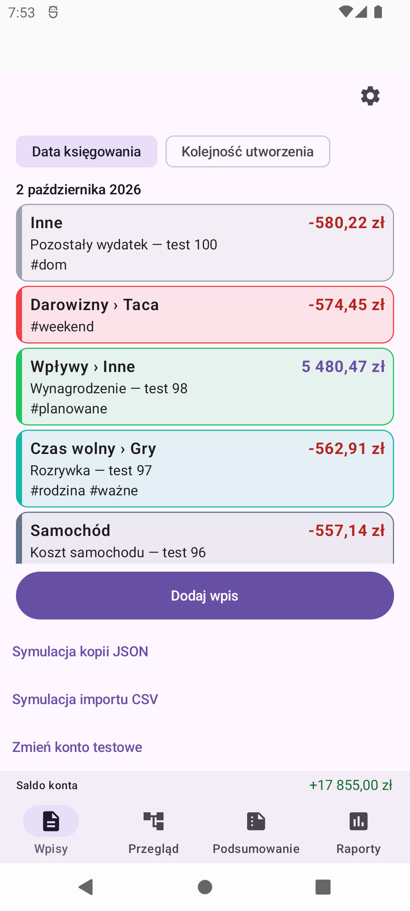

# Issue #126 — one-command DEV launcher

Verified locally on Windows on 2026-10-13, with JDK 21, Node 24 and the existing local Firebase CLI. No additional software was installed, production credentials/configuration were not changed, and no phone was connected or used.

## Real launcher checks

- `scripts/start-dev.ps1 -AvdName thesaurus_api31` recognized the running AVD and verified the existing `demo-thesaurus` suite by locator, live hub endpoints, listening-process ownership and CLI project argument. It built, installed with `-r` and opened the DEV app.
- Exported the synthetic Firebase data to a fresh ignored local directory before stopping the original suite. Both Auth and Firestore exports were present. No application or AVD data was cleared.
- Tested starting Firebase with `-FirebaseImportPath` and Android from a stopped state. A failed emulator startup was detected without proceeding to build/install. New emulator launches now disable Quick Boot snapshot load/save without wiping the disk; `-SoftwareRendering` uses SwiftShader without modifying the AVD configuration.
- After the fixes, one complete Windows PowerShell 5.1 invocation started **both** Android and Firebase from a stopped state, restored the exported snapshot, waited for actual boot/package-manager and Auth/Firestore readiness, assembled DEV, validated the APK package/minimum SDK, installed it and opened `MainActivity`. A PowerShell 7 reuse/cold-Android run also passed. Both services and the visible emulator remain running.
- Read the restored local Firestore namespace independently: one household, **100 entries**. The visible balance remains **17,855.00 PLN**. Original **1080x2400 / 420dpi / 100% font** settings are preserved. The screenshot below is the actual updated DEV app, not a test fixture.
- Also built the ordinary `debug` APK and ran `:app:signingReport` to verify the README phone-build commands. No physical-device installation is claimed: that step requires the user's phone and its debugging authorization.

## Automated checks

The Windows PowerShell 5.1 and PowerShell 7 suite passed **8/8 test suites, 192 assertions**, with no failures or skips. It executes helper/preflight tests, real child-process/batch-file tests and 13 mocked orchestration scenarios per shell. It verifies project and device selection, readiness before building, cold-boot flags, existing-service reuse, failures/timeouts, APK identity, install/launch ordering, CRCRLF responses from Windows ADB, paths with spaces, grouped JVM arguments and owned process-tree timeout cleanup. These tests never operate an actual Android device or Firebase suite. Existing CI assembly/shard/variant/project-safety checks also passed **15/15** locally.

The CI workflow runs the same launcher tests in separate Windows jobs for both PowerShell versions. Existing Android and Firebase CI checks remain enabled.

